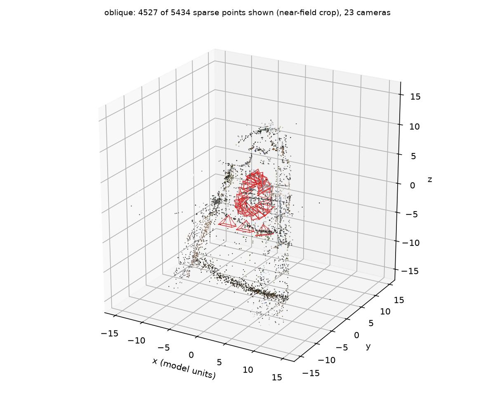
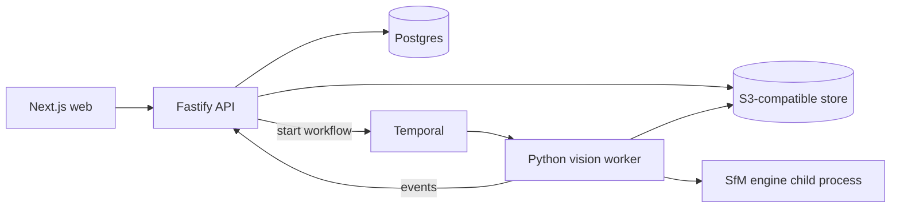

# ParallaxOps

**Distributed, quality-aware 3D reconstruction intelligence.**

Local-first platform for turning overlapping photographs into a sparse 3D reconstruction
(COLMAP/pycolmap SfM), with honest geometric diagnostics, reproducible benchmarks, and a
quality-aware compute controller. Built to run on one laptop and to scale out by adding workers.

> **Status: Gate 1 complete (real vision core).** The reconstruction engine, QC, exports and
> ground-truth evaluation work and are tested. The web app, API, workflow engine and
> controller experiments are **not built yet**; see the gate table. Nothing below is simulated.

## Gate status

| Gate | Scope | Status |
|------|-------|--------|
| 0 | Environment audit, ADRs, repo | done |
| 1 | Vision core: QC, SfM, PLY, poses, manifest, GT evaluation | **done, tested** |
| 2 | Async vertical slice: S3 + Postgres + Temporal + API + web | not started |
| 3 | Hardening: retries, cancellation, tenancy tests, limits | not started |
| 4 | Measurement: baseline vs quality-aware controller | not started |
| 5 | Optional: dense MVS, masking, multi-resolution viewer | not started |

Live status lives in [`STATE.md`](STATE.md); evidence per gate in [`docs/GATES.md`](docs/GATES.md).

## What works today

```text
vision reconstruct --input <photos/> --output <dir> [--ground-truth images.txt]
```

1. **Image QC**: decode validation, EXIF intrinsics, exact + perceptual duplicate detection,
   blur/exposure *heuristics*, byte/pixel/count budgets, path-escape rejection.
2. **Real SfM** via pycolmap 4.2.1 in a **supervised child process** (wall-clock, RAM and disk budgets,
   process-tree kill on cancel/timeout; Windows Job Object or POSIX process group).
3. **Diagnostics**: registered fraction, track statistics, reprojection error, triangulation angle,
   a documented quality rubric, and typed failure codes with capture advice.
4. **Exports**: `points_sparse.ply` (Open3D), `cameras.json`, COLMAP binary model, `manifest.json`
   (config, tool versions, image hashes, artifact SHA-256), `report.json`, PNG renders, logs.
   Artifact directories are published atomically.
5. **Ground-truth evaluation** (optional): camera-position and rotation error after a
   RANSAC + Umeyama similarity fit.

### Measured result (ETH3D `terrace`, 23 DSLR images, CPU only)

Run on the development laptop (Ryzen 9 8945HS, 16 threads; GPU unused). Source files:
[`benchmarks/results/gate1-terrace/`](benchmarks/results/gate1-terrace).

| Metric | Value |
|--------|-------|
| Images registered | 23 / 23 |
| Sparse 3D points | 5,434 |
| Mean track length | 3.92 |
| Reprojection error mean / median / p90 (px, 1600 px working size) | 0.845 / 0.766 / 1.488 |
| Median triangulation angle | 11.0 deg |
| Camera-position RMSE vs ground truth | 0.0240 GT units over a 7.65-unit camera spread (0.31%); the GT frame is ETH3D's laser-scan frame |
| Camera rotation error median / max | 0.52 / 0.68 deg |
| Wall clock (QC to export) | 72.6 s; SfM stage 57.8 s, peak process-tree RSS 3.8 GiB |

**Run-to-run variance is real.** Four back-to-back runs with the same seed gave 5,449 / 5,432 /
5,433 / 5,434 points and camera RMSE between 0.0225 and 0.0241. Multithreaded matching and bundle
adjustment are not bit-reproducible. Any future A/B claim must exceed this spread.



Renders are projections of the real PLY and camera poses (near-field crop; far background points
are omitted from the picture only). Data credit: ETH3D (see [`docs/DATASETS.md`](docs/DATASETS.md)).

## Quick start (Windows PowerShell; Linux/macOS are analogous)

```powershell
# Python 3.14 venv outside the repo
$env:PARALLAXOPS_HOME = "$env:LOCALAPPDATA\ParallaxOps"
uv venv --python 3.14 "$env:PARALLAXOPS_HOME\venv"
uv pip install --python "$env:PARALLAXOPS_HOME\venv\Scripts\python.exe" -e "services/vision-worker[dev]"

# Real data (downloaded from the original host; never committed)
& "$env:PARALLAXOPS_HOME\venv\Scripts\python.exe" scripts/fetch_dataset.py terrace

# Reconstruct and evaluate against ground truth
$d = "$env:PARALLAXOPS_HOME\data\eth3d\terrace\terrace"
& "$env:PARALLAXOPS_HOME\venv\Scripts\vision.exe" reconstruct `
  --input "$d\images\dslr_images" --output runs\terrace `
  --ground-truth "$d\dslr_calibration_jpg\images.txt"
```

Exit codes are typed: `0` success; `10+` map to `DiagnosticCode` (see
`services/vision-worker/src/parallaxops_vision/diagnostics.py`), e.g. too few images, no features,
low registration, timeout, cancelled.

Tests: `make test` (lint, types, unit; no downloads) and `make test-integration` (real ETH3D data).

## Architecture

Control plane (TypeScript) and computation plane (Python) are separated; blobs never enter Postgres
or Temporal history. Decisions are recorded in [`docs/adr/`](docs/adr).



Only the **vision worker and engine** exist today; everything else in the diagram is planned
(Gate 2+). See [`docs/ENVIRONMENT.md`](docs/ENVIRONMENT.md) for the host audit and why the local
stack is native-first.

## Limitations (current)

- **Sparse reconstruction only**; no dense surface or mesh yet.
- **No metric scale** from images alone. Metric numbers above exist only because the benchmark
  ground truth supplies a scale.
- pycolmap from PyPI is **CPU-only**; GPU/dense paths use the COLMAP CUDA binary and are not yet
  wired or measured.
- QC heuristics (blur, exposure, duplicates) do not prove overlap or reconstructability.
- One scene evaluated so far; results do not generalize.
- ETH3D data is treated as **CC BY-NC-SA 4.0 (unconfirmed)** and is never redistributed here.

## Privacy and security notes

Images stay on the local machine. No cloud services or API keys are used. There is **no login
system by design** ([ADR 0004](docs/adr/0004-tenancy-without-accounts.md)); tenant isolation
is by scoping and is added with the API in Gate 2/3.

## License

MIT for this repository's code. Third-party data keeps its own license.
