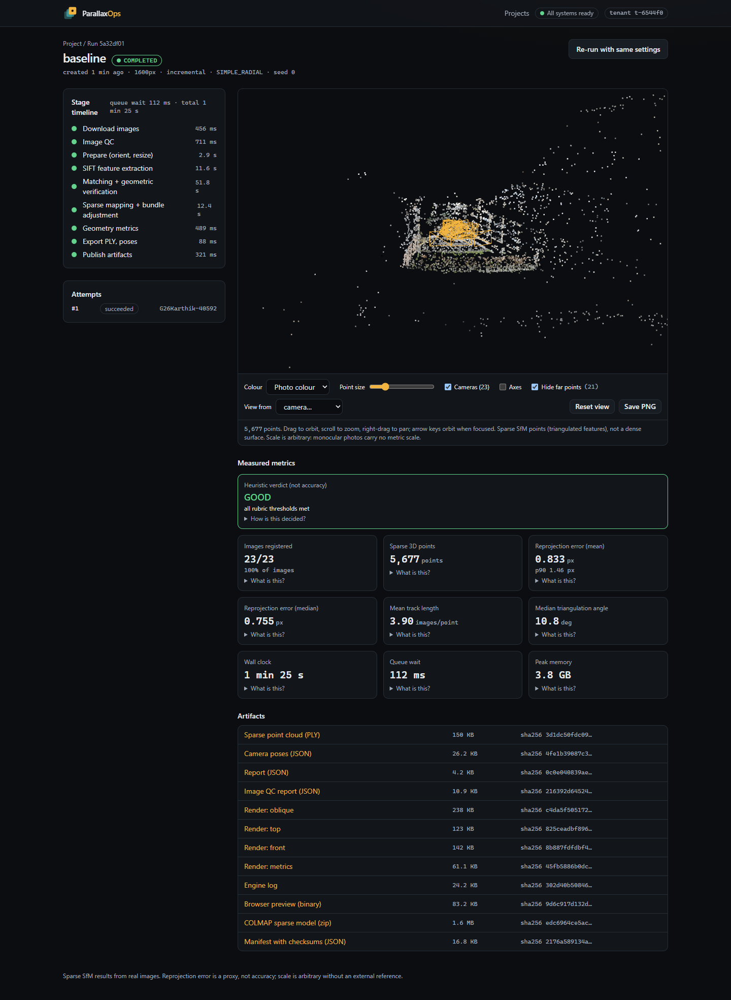
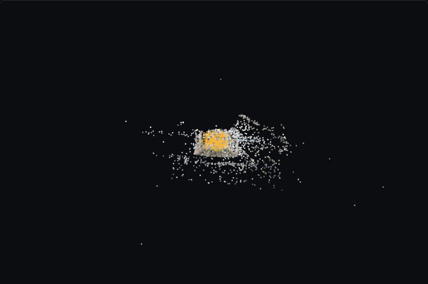
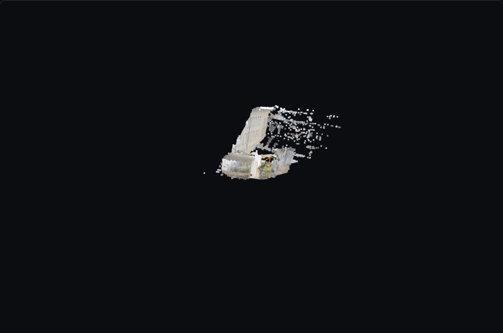
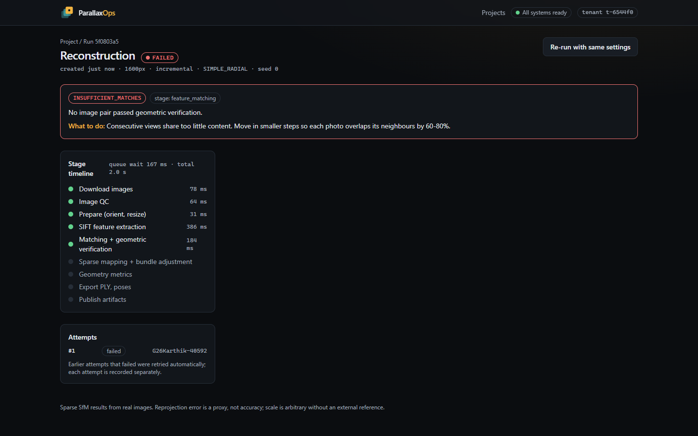

<div align="center">



**Local-first 3D reconstruction from photographs, with durable workflows, honest geometric QA, and measured results.**

[](https://github.com/G26karthik/parallaxops/actions/workflows/ci.yml)
[](LICENSE)
[](services/vision-worker)
[](package.json)
[](docs/ENVIRONMENT.md)
[](apps/web)
[](docs/ARCHITECTURE.md)

</div>

<p align="center">
  
</p>

> Real photographs in, a real COLMAP reconstruction out, with the timeline, the 3D scene and every
> metric coming from an actual run on a laptop. The screenshot above is the live app on the ETH3D
> *terrace* scene. Nothing in this repository is simulated, and where something is a proxy or a
> negative result, it says so.

##  Get started

Windows 11 (PowerShell). No Docker, no paid services, no API keys. Everything it installs lives under
`%LOCALAPPDATA%\ParallaxOps`, never in the repo.

```powershell
git clone https://github.com/G26karthik/parallaxops && cd parallaxops
.\scripts\dev.ps1 setup      # pinned tools, Python 3.14 venv, pnpm install, Postgres init (idempotent)
.\scripts\dev.ps1 up         # Postgres, S3 store, Temporal, API, worker, web
start http://localhost:3000  # upload 15-60 overlapping photos, then Start reconstruction
```

Prefer the command line? The vision core is a plain CLI (`vision reconstruct --input <photos>
--output <dir>`); see [Quick CLI](#quick-cli). Linux/macOS work for the vision core and tests; the
one-command stack script is Windows-only today (a container path exists but is
[unverified](infra/README.md)).

##  What it does

1. **Upload and inspect.** Direct-to-object-storage presigned uploads; server-side magic-byte and
   SHA-256 verification, deduplication, size/count caps, hostile-filename sanitisation.
2. **Preflight.** Blur, exposure, near-duplicate and EXIF checks, labelled as heuristics.
3. **Reconstruct.** Real COLMAP/pycolmap structure-from-motion in a supervised child process
   (wall-clock, RAM and disk budgets; kill-on-close process tree), scheduled by Temporal with one
   heavy job at a time. Optional GPU dense reconstruction.
4. **Inspect.** Live stage timeline, interactive Three.js point cloud with camera frusta, measured
   metrics with units, sources and plain-language caveats, checksummed artifact downloads,
   run-to-run comparison.
5. **Fail usefully.** Typed diagnostics with capture advice (`INSUFFICIENT_MATCHES`: "move in
   smaller steps, overlap neighbours 60-80%").

<table>
<tr>
<td width="50%"><br><sub>Sparse SfM cloud and camera frusta from the 23-image terrace run.</sub></td>
<td width="50%"><br><sub>Dense MVS cloud of the same scene (249k points, GPU, decimated for the browser).</sub></td>
</tr>
<tr>
<td colspan="2"><br><sub>A deliberately hopeless capture fails with a typed, actionable diagnostic.</sub></td>
</tr>
</table>

##  Measured results

All numbers are measured on one laptop (Ryzen 9 8945HS, 16 threads, RTX 4060 8 GB, Windows 11) and
come from files in [`benchmarks/results/`](benchmarks/results). Full tables, conditions and caveats:
[PERFORMANCE](docs/PERFORMANCE.md), [EXPERIMENTS](docs/EXPERIMENTS.md).

| What | Result |
|------|--------|
| Reconstruction, ETH3D terrace, 23 DSLR images, 1600 px, CPU | 23/23 registered, 5.4k sparse points, 0.85 px mean reprojection, **camera position error 0.31% of rig spread vs ground truth**, 0.52 deg median rotation error, 87 s through the platform |
| Dense reconstruction, same scene, GPU (opt-in) | **249k points** at 1000 px; dense stage 344 s through the platform (a standalone probe took 773 s; the 2x spread is unexplained, likely laptop GPU power state); **0.7 to 1.5 GiB** of the 8 GiB GPU memory in use; falls back to sparse with a typed warning when unavailable |
| Job submit to HTTP 202 | 46 ms |
| API under load, 32 concurrent users, idle / during a reconstruction | p95 351 ms / 433 ms, 0 errors |
| Second job while one runs | queued 90 s; never more than one heavy job active |
| Cancel a running job | 6.1 s to `CANCELLED`, engine tree killed, GPU/CPU slot free |
| Worker hard-killed mid-job | attempt recorded as failed, retried on a new worker, job completes; no orphan engine, no scratch left |
| Run-to-run spread, same config and seed | 5,432 to 5,449 sparse points; one in three runs of a degraded scene produced a wrong model |

Controller experiment: the quality-aware controller **did not pass its pre-registered test** (details
below). That result is part of the project, not hidden from it.

##  Reliability, proven with real processes

The platform's contracts are verified against a real Postgres, object store, Temporal server, worker
and browser, not mocks. See [ARCHITECTURE](docs/ARCHITECTURE.md) for the table mapping each contract
to its test.

- **Durable and idempotent.** `Idempotency-Key` per tenant (race-tested); the workflow outbox starts
  jobs even if the engine was down at submit time.
- **Safe retries.** Insert-only attempt records; a killed worker's attempt is closed as "worker
  lost"; artifacts publish under attempt-specific prefixes, manifest last.
- **Isolation.** Tenant scoping on every row, query and object key; cross-tenant ids return 404; the
  worker refuses keys outside the job's own prefix.
- **Resource safety.** One heavy job per worker; budgets enforced by a supervisor; orphaned scratch
  from a killed worker is reaped by an owner-pid sweeper; janitor for abandoned uploads and expired
  artifacts, all counted in Prometheus.
- **Version skew.** Workflow and artifact contracts are versioned; unknown majors fail the job with a
  clear message instead of hanging ([VERSIONING](docs/VERSIONING.md)).

##  The controller experiment (a negative result)

The brief asked for a quality-aware controller that spends more compute only when a result is weak,
evaluated against a fixed baseline with ground truth. The plan was committed before any run
([EXPERIMENT_PLAN](docs/EXPERIMENT_PLAN.md)); results are in [EXPERIMENTS](docs/EXPERIMENTS.md).

| Hypothesis | Verdict |
|------------|---------|
| H1: helps where the baseline is weak (coverage, at <= 2.5x cost) | Not supported: +27 to +37 points of registered images, but at 3x cost |
| H2: no waste on clean data | Supported: one attempt, -3% wall clock |
| H3: no accuracy regression | Not supported by the rule; on the two failing cells the configuration was identical, so it is noise |

The important finding is *why*: the controller preferred the **global-mapper** model, which
registered more images and kept a low reprojection error, but whose cameras were 20 to 70 times
further from ground truth. **Registered fraction and reprojection error look healthy on wrong
geometry.** A post-hoc analysis shows its extra images were mostly badly placed, and that the same
configuration sometimes yields a wrong model by chance (one in three baseline runs on one variant).
The write-up lists what a v2 should do; none of it was tuned on these results.

## Quick CLI

```powershell
$py = "$env:LOCALAPPDATA\ParallaxOps\venv\Scripts"
& "$py\python.exe" scripts/fetch_dataset.py terrace       # ETH3D, downloaded from the original host
$d = "$env:LOCALAPPDATA\ParallaxOps\data\eth3d\terrace\terrace"
& "$py\vision.exe" reconstruct --input "$d\images\dslr_images" --output runs\terrace `
  --ground-truth "$d\dslr_calibration_jpg\images.txt"
```

Typed exit codes: `0` success, `10+` per `DiagnosticCode` (too few images, no features, low
registration, timeout, cancelled, ...). Output: `points_sparse.ply`, `cameras.json`, a COLMAP model,
`report.json`, `manifest.json` (config, tool versions, SHA-256 of every input and artifact), renders.

## API in a minute

Interactive docs at `http://localhost:4000/docs`; spec in [`docs/openapi.json`](docs/openapi.json),
typed client generated from it. Every `/v1` call needs an `X-Tenant-Id` header (scoping, not
authentication; see [SECURITY](docs/SECURITY.md)).

```bash
T='X-Tenant-Id: t-demo0001abcdef12'
curl -s -X POST localhost:4000/v1/projects -H "$T" -H 'content-type: application/json' -d '{"name":"Terrace"}'
# {"id":"0bb884fb-...","name":"Terrace","description":null,"createdAt":"2026-10-23T22:46:54.404Z"}

# ...create a dataset, upload via presigned URLs, then (202 Accepted, idempotent):
curl -s -X POST localhost:4000/v1/datasets/$DATASET/jobs -H "$T" -H "Idempotency-Key: demo-0001" \
     -H 'content-type: application/json' -d '{"config":{"maxImageSize":1600}}'
# {"id":"...","state":"QUEUED","idempotentReplay":false}

curl -s localhost:4000/v1/jobs/$JOB -H "$T"      # state, stages, attempts, metrics, diagnostic
curl -s localhost:4000/v1/jobs/$JOB/artifacts -H "$T"   # presigned, checksummed downloads
curl -s localhost:4000/readyz                    # database, object store, workflow engine
```

## Tests

| Suite | Count | What it needs |
|-------|------:|---------------|
| Python unit (QC, supervisor, controller, scratch sweeper, worker, engine failure mapping, contract sync, dense wrapper, ground truth) | 69 | nothing |
| Python integration (real COLMAP on ETH3D) | 2 | the downloaded scene |
| TypeScript (state machine, contracts, API on in-process Postgres incl. concurrency races, web libs) | 68 | nothing |
| End-to-end against the live stack (API, browser incl. axe accessibility, failure injection, races, presigned URLs, dense GPU) | 19 | `dev.ps1 up`, dataset, GPU for one |

CI runs `python scripts/check.py`: workflow validation (actionlint), ruff, mypy for three operating
systems, pytest, Biome, `tsc`, vitest and a production web build. The same script is the local
pre-push hook, so a red run should not reach GitHub ([CI](docs/CI.md)).

## Documentation

[Architecture](docs/ARCHITECTURE.md) · [ADRs](docs/adr) · [Environment audit](docs/ENVIRONMENT.md) ·
[Datasets and licensing](docs/DATASETS.md) · [Performance](docs/PERFORMANCE.md) ·
[Experiments](docs/EXPERIMENTS.md) · [Security](docs/SECURITY.md) · [Operations](docs/OPERATIONS.md) ·
[Versioning](docs/VERSIONING.md) · [Gate evidence](docs/GATES.md) · [Infrastructure](infra/README.md)

## Limitations

- **Sparse by default; dense is opt-in** and needs an NVIDIA GPU plus the CUDA COLMAP build. No mesh
  or surface is produced.
- **No metric scale** from images alone. The ground-truth comparisons are metric only because ETH3D
  supplies a scale.
- QC flags (blur, exposure, duplicates) are heuristics and do not prove reconstructability.
- Evaluated on **two scenes**, mostly one, with synthetic degradations. Nothing generalises yet.
- The controller (v1) is **not recommended**; see the experiment. Dynamic-object masking was not
  attempted.
- One heavy job per **worker process**; there is no fleet-wide GPU lease, no multi-host test, no
  Kubernetes manifests, and the container path is unverified. Scale-out is a design, not a claim.
- No login system by design. Tenant ids are not secrets (ADR 0004).
- ETH3D imagery is treated as CC BY-NC-SA 4.0 (**unconfirmed**) and is never redistributed; the
  screenshots show rendered point-cloud views for research demonstration with attribution
  ([DATASETS](docs/DATASETS.md)). Data credit: Schoeps et al., CVPR 2017.

## Roadmap

1. Controller v2 with an independent consistency check and re-run-to-agree acceptance, pre-registered
   and evaluated on more scenes.
2. Dynamic-object masking comparison (oracle masks first, then a segmentation model).
3. A distributed capacity lease (Postgres row with heartbeat expiry) and a tested multi-worker run.
4. Verify the Compose path, then Kubernetes manifests.
5. Multi-resolution (octree) streaming for large dense clouds.

## License

MIT for this repository's code. Third-party data and tools keep their own licenses.
