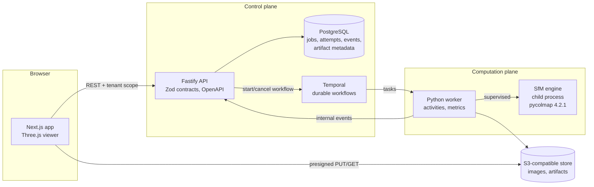

# Architecture

ParallaxOps separates a **control plane** (state, contracts, orchestration entry points) from a
**computation plane** (CPU/GPU-heavy vision work). Everything below runs on one laptop today;
the boundaries are drawn so each part scales out independently. What is *verified* versus *designed
for scale* is spelled out in the last section.

## Request path (what happens when you click "Start reconstruction")

1. `POST /v1/datasets/{id}/jobs` validates the config, checks tenant quotas, inserts the job
   (idempotent per tenant via `Idempotency-Key`), snapshots the input list to an object-store
   manifest, marks the job `QUEUED`, and starts the Temporal workflow. It returns **202 in tens of
   milliseconds** (measured: 46 ms). If the workflow engine is down the job is still durable and a
   reconciler starts it later.
2. The workflow (`ReconstructionWorkflow`) schedules `run_reconstruction` on the `vision-heavy`
   task queue. That queue is served by a worker with `max_concurrent_activities = 1`, so a second job
   simply waits in `QUEUED` (visible as queue wait).
3. The activity downloads the images, **verifies each SHA-256**, runs the pipeline (QC, preparation,
   engine child process, metrics, export), uploads artifacts under an attempt-specific prefix
   (manifest last), and heartbeats every second. Progress events go to the API for the live
   timeline.
4. The workflow reports the terminal event (`completed`, `failed`, `cancelled`) through a retrying
   activity, so the result reaches the API even if the worker died right after finishing.
5. The browser polls the job, then fetches presigned URLs for the point-cloud preview and camera
   poses and renders them.

## Key decisions (see `docs/adr/`)

| Topic | Decision |
|-------|----------|
| Engine isolation | SfM runs in a supervised child process: kill-on-close Job Object (Windows) or process group (POSIX), wall-clock, RSS and disk budgets. ADR 0001 |
| Local stack | Native binaries, all state outside the repo. ADR 0002 |
| Storage | S3 adapter; SeaweedFS locally (MinIO no longer ships Windows binaries). ADR 0003 |
| Single DB writer | The API owns the schema (Drizzle). The worker reports through an authenticated internal endpoint. ADR 0003 |
| Tenancy | Scoping by tenant id on every row, query and object key; no accounts by design. ADR 0004 |
| Evaluation | Ground truth beats proxies; variance is measured before claiming a win. ADR 0005 |
| Contracts | Versioned workflow input and artifact schemas; unknown majors are rejected. `docs/VERSIONING.md` |

## State machine

`CREATED → UPLOADING → QUEUED → PREPROCESSING → RECONSTRUCTING → EVALUATING → COMPLETED`, with
`FAILED` and `CANCELLED` reachable from any non-terminal state and retries re-entering `QUEUED`.
Transitions are defined once (`packages/contracts/src/state.ts`) and enforced in SQL under a row
lock; terminal states are immutable, so a late event can never rewrite a finished job. Attempts
(`job_attempts`) are insert-only records of each execution, including "worker lost" attempts.

## Reliability contracts (and the test that proves each)

| Contract | Proof |
|----------|-------|
| API returns immediately; long work is async | `test_full_reconstruction_job_produces_real_artifacts` (202 in 46 ms) |
| Idempotent create, per tenant, race-safe | `jobs.test.ts` (key replay, key reuse with a different body, 5 concurrent identical requests converge on one job) |
| One heavy job at a time; the second queues | `test_second_job_queues_behind_the_single_heavy_slot` |
| Cancel kills the engine tree and frees the slot | `test_cancel_running_job_stops_engine_and_frees_slot`, `test_supervisor.py` (grandchild killed) |
| A killed worker leaves no orphan engine and the work is retried safely | `test_killed_worker_leaves_no_orphan_engine_and_work_is_retried` |
| API restart mid-job loses nothing | `test_api_restart_mid_job_loses_nothing` |
| No cross-tenant read, cancel, upload, download, or artifact attachment | `tenancy.test.ts`, `jobs.test.ts` (foreign-prefix artifacts ignored) |
| Uploads are verified (type, size, magic bytes, SHA-256) and deduplicated | `uploads.test.ts` |
| Failed jobs return an actionable typed diagnostic | `test_failed_job_reports_actionable_diagnostics`, UI journey |
| Cleanup is observable and tested | `jobs.test.ts` (janitor), worker scratch metrics, `test_no_scratch_files_or_engines_remain` |

## Verified vs designed for scale

- **Verified on one laptop:** everything in the table above, with real processes, a real object
  store and a real workflow engine, plus a Linux CI replica.
- **Designed for scale, not load-tested:** adding workers (they share nothing but Temporal, the
  object store and the API; no shared disk), multiple API replicas (stateless; the reconciler is
  idempotent), a managed S3 and Postgres (adapters and migrations).
- **Not built:** a fleet-wide GPU/CPU lease. The heavy-job cap is *per worker process*. A
  multi-host cap would need a distributed lease (for example a Postgres row with heartbeat expiry);
  it is a roadmap item, not a claim. No Kubernetes manifests yet.
