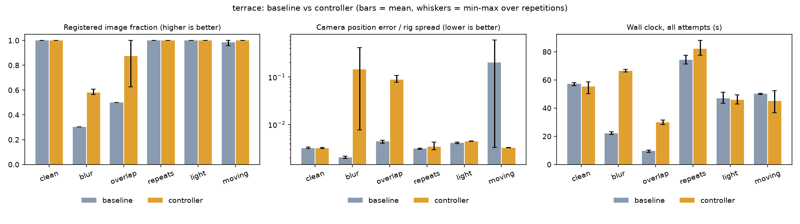

# Experiment results: baseline vs quality-aware controller (v1)

Evaluation of the policy defined in [`EXPERIMENT_PLAN.md`](EXPERIMENT_PLAN.md), which was committed
before any controller run. Raw data: `benchmarks/results/gate4/` (`runs.jsonl`,
`runs_posthoc.jsonl`, `summary.*`, `variants_*.json`). Reproduce with
`python benchmarks/run_experiment.py` then `python benchmarks/report.py`.

**Bottom line: the v1 controller did not pass its own pre-registered test.** It recovers more
images on weak captures, but at about three times the compute, and the extra coverage is
geometrically wrong. The metrics the controller trusts (registered fraction, reprojection error)
looked fine on those wrong models. This is a negative result and it is reported as one.

## Conditions

AMD Ryzen 9 8945HS (8 cores / 16 threads), 31.2 GiB RAM with roughly 9 to 11 GiB free at start,
RTX 4060 Laptop (unused: CPU only), Windows 11. Python 3.14.2, pycolmap 4.2.1 (CPU), Open3D 0.20.0.
The rest of the stack (API, worker, web, Postgres, Temporal, object store) was stopped during the
runs. Arms ran interleaved per (variant, repetition). Engine seeds 0, 1, 2 for repetitions 0, 1, 2;
multithreaded matching and bundle adjustment add nondeterminism on top (see ADR 0005).
Scene `terrace`: 3 repetitions per cell, 36 runs, 1600 px. Scene `relief`: 1 repetition per cell,
12 runs, 1200 px. Ground truth is ETH3D's camera poses; the controller never saw it.

## Terrace (3 repetitions; mean [min-max])

| variant | arm | attempts | registered fraction | sparse points | GT position error / rig spread | wall clock (s) |
|---------|-----|---------:|---------------------|--------------:|--------------------------------|---------------:|
| clean | baseline | 1 | 1.000 [1.000-1.000] | 5327 | 0.0032 [0.0031-0.0033] | 57.2 |
| clean | controller | 1 | 1.000 [1.000-1.000] | 5329 | 0.0032 [0.0031-0.0033] | 55.4 |
| blur | baseline | 1 | 0.304 [0.304-0.304] | 869 | 0.0021 [0.0019-0.0022] | 22.1 |
| blur | controller | 3 | 0.580 [0.565-0.609] | 2284 | 0.1447 [0.0077-0.4157] | 66.3 |
| overlap | baseline | 1 | 0.500 [0.500-0.500] | 339 | 0.0044 [0.0040-0.0047] | 9.5 |
| overlap | controller | 3 | 0.875 [0.625-1.000] | 352 | 0.0880 [0.0777-0.1070] | 30.0 |
| repeats | baseline | 1 | 1.000 [1.000-1.000] | 7249 | 0.0031 [0.0030-0.0032] | 74.2 |
| repeats | controller | 1 | 1.000 [1.000-1.000] | 7225 | 0.0034 [0.0029-0.0043] | 82.2 |
| light | baseline | 1 | 1.000 [1.000-1.000] | 4056 | 0.0041 [0.0040-0.0042] | 47.0 |
| light | controller | 1 | 1.000 [1.000-1.000] | 4051 | 0.0045 [0.0044-0.0045] | 45.8 |
| moving | baseline | 1 | 0.986 [0.957-1.000] | 3449 | 0.1994 [0.0033-0.5917] | 50.1 |
| moving | controller | 1 | 1.000 [1.000-1.000] | 4030 | 0.0033 [0.0032-0.0033] | 45.2 |

Position error is the camera-position RMSE after a RANSAC similarity fit, divided by the spread of
the ground-truth camera rig, over the images **that arm registered**. Lower is better, and it
is only comparable between arms when they registered the same images (see the post-hoc analysis).

Relief (n = 1 per cell, so no noise floor): `blur` baseline 0.548 registered, error ratio 0.0033;
controller 0.613 registered, **error ratio 14.6**. `overlap` baseline 0.727 / 0.0044; controller
1.000 / **8.9**. All other variants matched the baseline (same configuration, one attempt).

## Pre-registered verdicts

| | Result | Why |
|---|--------|-----|
| **H1** helps where the baseline registers < 90% (>= +10 pp, outside baseline range, <= 2.5x wall clock) | **Not supported** | Coverage gains are real and outside the baseline range (blur +27.5 pp, overlap +37.5 pp), but they cost 3.0x and 3.15x wall clock, over the 2.5x cap. Relief (n = 1): blur gains only 6.5 pp. |
| **H2** no waste on clean data (attempt 1 accepted, <= 5% overhead) | **Supported** | One attempt in every clean run; wall clock -3% (inside noise). |
| **H3** no accuracy regression where both arms register >= 90% | **Not supported by the rule, but not a real regression** | The controller exceeded the baseline's max on `repeats` and `light` by about 0.0003 and 0.0002 of the rig spread. In both, the controller ran the **identical configuration** (one attempt), so the gap is run-to-run noise that the 3-repetition min-max range underestimates. `moving` is flagged "ok" only because one baseline run went wrong (below). |

## What the data actually shows

1. **More registered images, worse geometry.** In every degraded case the controller's winning
   attempt was its last one, the **global mapper**, which registers more images than the incremental
   mapper. The controller ranks attempts by registered fraction and then reprojection error, and
   both look healthy on bad geometry: reprojection error stayed at 0.50 to 0.83 px while camera
   position error against ground truth rose 20x (overlap) to 70x (blur) on terrace and up to
   thousands of times on relief.
2. **Post-hoc diagnosis** (`benchmarks/posthoc.py`; exploratory, not pre-registered; blur and
   overlap re-run 3x with per-image errors stored). On the images **both** arms registered, the
   controller's cameras were less accurate: blur 0.7 to 1.7% of rig spread vs 0.15 to 0.17% for
   the baseline; overlap 0.82% vs 0.36%. Of the images only the controller registered, 6 of 7 were
   badly placed (> 5% of spread) in two of three blur repetitions and 1 of 4 in every overlap
   repetition. So the extra coverage is not a free gain, and the extra model also moves the shared
   cameras.
3. **The same configuration can give a good or a bad model.** In `moving`, one of three baseline
   runs produced a wrong model (position error 0.59, point count 2,271 versus about 4,000 in the other
   two). Its registered fraction (0.957) and reprojection error (1.06 px) were still under the
   controller's acceptance thresholds (the platform's heuristic verdict did mark that run "fair"
   instead of "good", but nothing acted on it). The controller's three runs were fine, but it ran the *same*
   configuration (one attempt), so that difference is nondeterminism, not a controller effect. Fixed
   seeds do not make multithreaded COLMAP deterministic. This is a reliability finding in its own
   right.
4. **The compute ratio is inflated by the baseline giving up early.** On blur and overlap the
   baseline registers a few images and stops in 9 to 22 s; any attempt to recover costs more by
   construction.
5. **Wall-clock noise is large on this machine.** Post-hoc blur controller runs ranged from 63 s to
   102 s for identical work. Compute-cost ratios are indicative, not precise.

## Limitations

- One real scene with three repetitions, plus one scene with one repetition. Nothing here
  generalises.
- Degradations are synthetic and chosen by me; the thresholds in the plan were fixed in advance,
  not tuned, and not validated elsewhere.
- Ground truth is camera poses only; there is no ground-truth surface, so point-cloud accuracy is
  unmeasured.
- Error ratios are computed on each arm's own registered set (hence the post-hoc analysis).
- The noise floor from three repetitions is too small: identical configurations exceeded it (H3).
- CPU only. No claim is made about the GPU path.

## What this implies (not yet built or tested)

- Do not rank attempts by registered fraction. Require an **independent consistency check** that
  needs no ground truth, for example agreement of shared camera poses between attempts, or consensus
  of two independent runs, before a more complete model replaces a more conservative one.
- Guard or remove the global-mapper strategy until it passes such a check.
- Re-run the baseline when a result looks marginal: nondeterminism makes a single run an unreliable
  witness. A "two runs agree" acceptance rule is cheap compared with a 3x recovery ladder.
- Use more repetitions (at least 5) and more scenes before drawing conclusions.

A v2 would need its own pre-registered plan and fresh data; none of the above was tuned on these
results.
